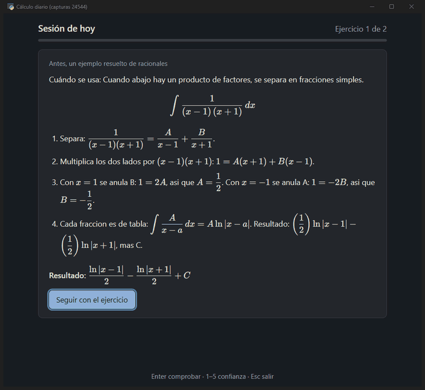
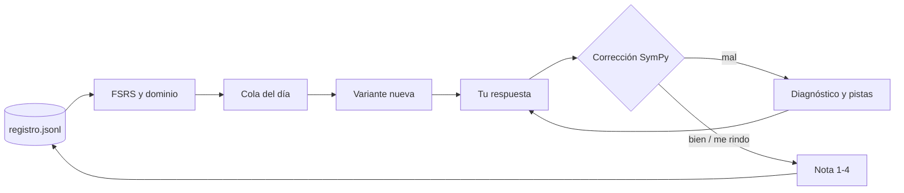

<div align="center">

# ∫ calculo-diario

**Diez minutos de cálculo al día, programados con FSRS y corregidos con SymPy — sin conexión, en tu ordenador.**

Práctica diaria de derivadas, integrales, derivadas parciales y EDOs: elige lo que toca hoy, genera una variante nueva de cada ejercicio, corrige el resultado escrito como en clase y te dice *por qué* falla.

[](https://www.python.org/)
[](LICENSE)
[](README.md#tests)
[-0078D6?logo=windows&logoColor=white)](#empezar)
[](README.md#engineering-highlights)

[English](README.md) · [Notas de diseño (EN)](programa/docs/DESIGN.md) · por [Ricardo Eiras](https://github.com/RicardoeeE) — estudiante de Ingeniería Mecánica



</div>

## Por qué

- **Las tarjetas de memoria no entrenan procedimientos.** → Cada ficha es una *familia* con parámetros: cada repaso es una variante nueva.
- **Ponerse nota a uno mismo tiene sesgo.** → La nota sale de hechos (acierto, pistas, intentos fallidos, tiempo, confianza) y FSRS decide el próximo repaso.
- **«Mal» no enseña nada.** → Se acepta cualquier forma equivalente y se nombra el error típico (cadena, factor, signo, límites al revés…).

## Qué trae

- 🗓️ Repaso espaciado FSRS: 5 ejercicios al día (2 el día mínimo), sin pasarse nunca del cupo.
- 🎲 172 fichas de 25 técnicas, 87 de ellas con parámetros; todas las claves comprobadas con SymPy.
- ✅ Corrección simbólica y por muestreo; avisos de `+C` y de `ln|x|`.
- ✍️ Se escribe como en el papel (`e^2x/2 + C`, `x sen x`, `2±3i`) con vista previa en KaTeX.
- 🪜 Tres pistas graduadas, solución paso a paso y ejemplos resueltos con huecos.
- 📈 Dominio por técnica (Beta-Binomial), escalera de técnicas y repetición implícita.
- 📝 Preparación de examen, simulacro cronometrado y prueba de nivel.
- 🔒 Datos en JSON Lines que solo se amplían, con cerrojo, copias verificadas con SHA-256 y git.

## Empezar

1. `git clone https://github.com/RicardoeeE/calculo-diario-app.git` (hace falta Python 3.13).
2. **Windows:** doble clic en `Practicar.bat` (la primera vez prepara el entorno, 1-2 min). **Cualquier sistema:** `python -m venv .venv`, instala `programa/requirements.txt` y `programa/requirements-ventana.txt`, y ejecuta `python programa/practica.py ventana` (o `hoy` para la terminal).
3. Elige tu confianza (1-5), resuelve en papel, escribe solo el resultado y pulsa Enter.

La ventana está probada en Windows; en Linux y macOS funciona la terminal y la ventana no está probada.

## Cómo funciona



Los detalles (nota objetiva, FSRS, dominio, grafo de técnicas, protección de datos) están en las [notas de diseño](programa/docs/DESIGN.md) y en el [README en inglés](README.md#engineering-highlights). Para elegir técnica antes de integrar: [hoja de reconocimiento](programa/docs/hoja-reconocer.md).

## Pruebas

```bash
.venv\Scripts\python.exe -B -m unittest discover -s programa/tests -t programa   # 457 pruebas (454 en verde, 3 omitidas)
.venv\Scripts\python.exe programa\practica.py ventana --prueba                   # humo de la ventana
```

## Licencia

Código: [MIT](LICENSE) © 2026 Ricardo Eiras. Documentación de `programa/docs/`: CC BY 4.0. KaTeX: MIT.

<div align="center">

**Si te ayuda a estudiar, dale una ⭐**

</div>
