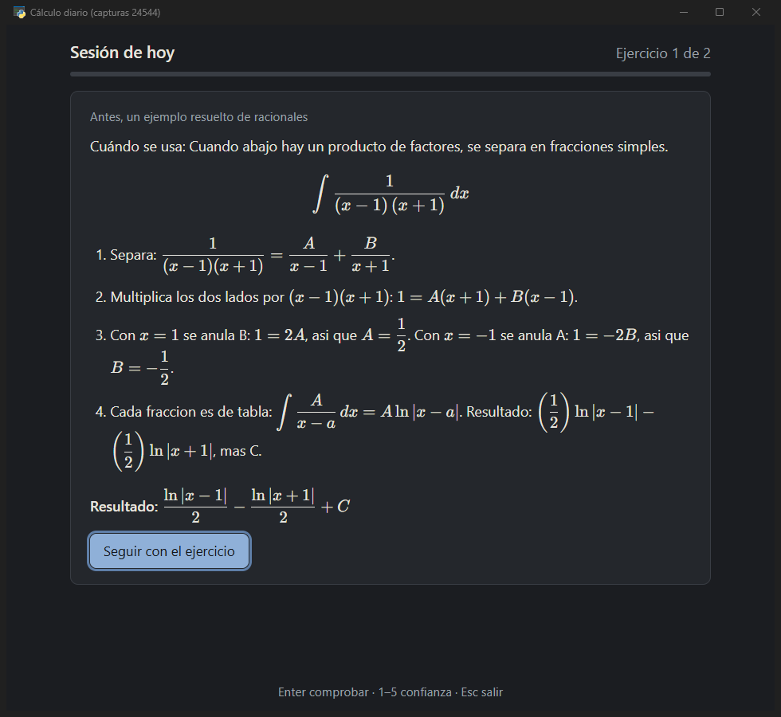
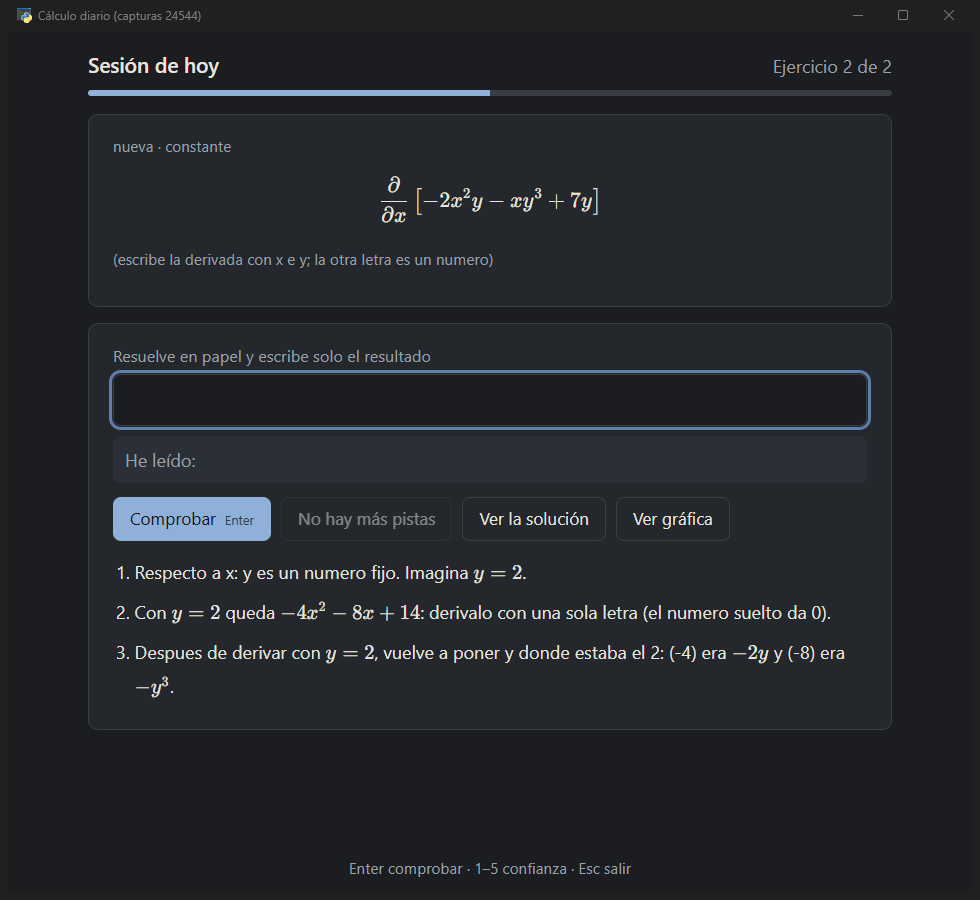
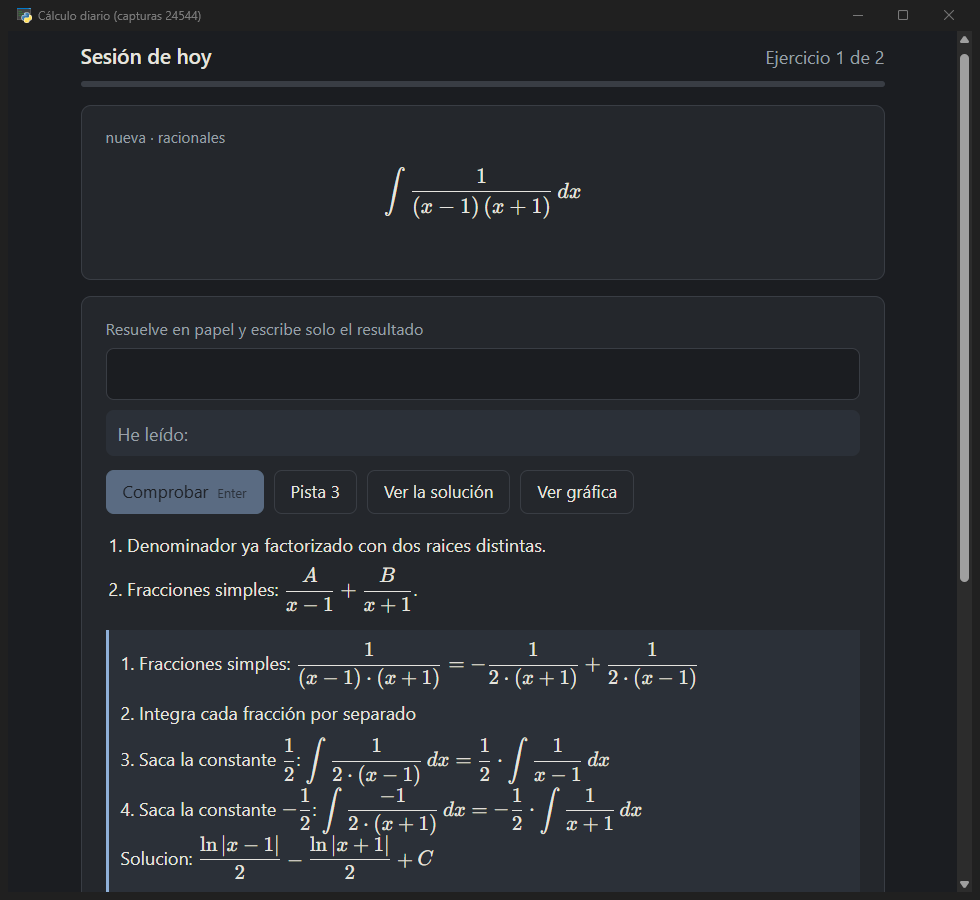
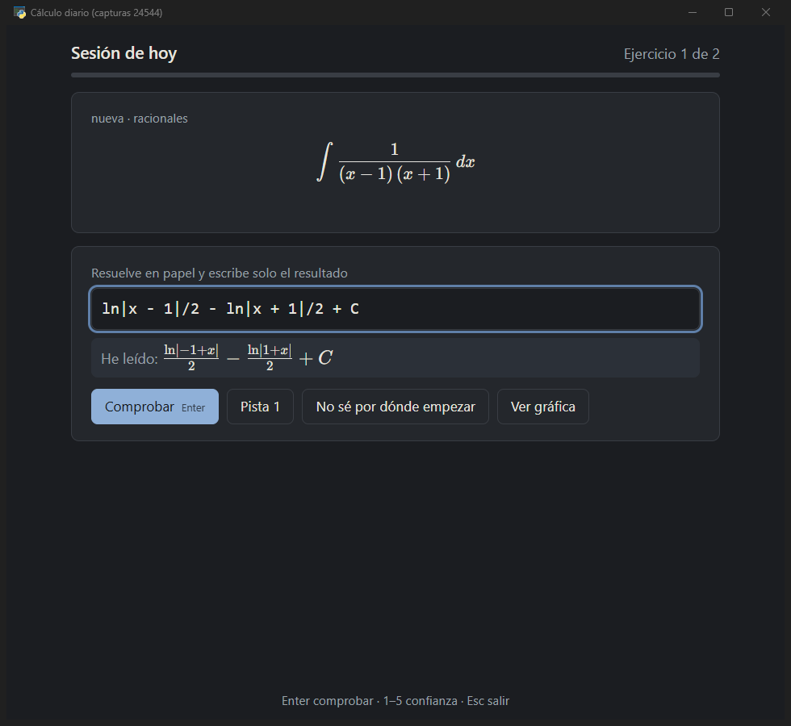
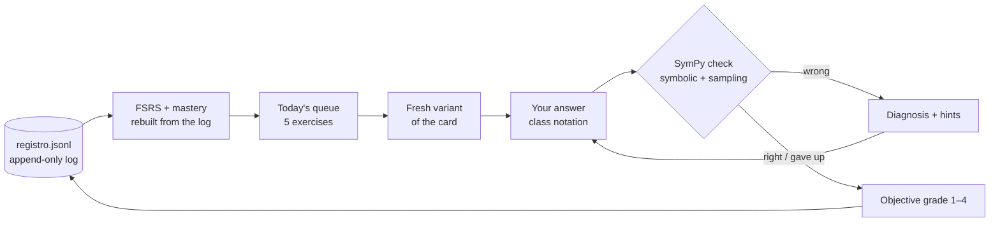

<div align="center">

# ∫ calculo-diario

**Ten minutes of calculus a day, scheduled by FSRS and checked by SymPy — offline, on your own machine.**

A local practice app for derivatives, integrals, partial derivatives and ODEs: it picks what is due today, generates a fresh variant of each exercise, checks the answer you write in class notation and tells you *why* it is wrong.

[](https://www.python.org/)
[](LICENSE)
[](#tests)
[-0078D6?logo=windows&logoColor=white)](#quick-start)
[](#engineering-highlights)

[Español](README.es.md) · [Design notes](programa/docs/DESIGN.md) · by [Ricardo Eiras](https://github.com/RicardoeeE) — Mechanical Engineering student


</div>

## Why

- **Flash cards don't train procedures.** Remembering that ∫ x·e^(x²) dx = e^(x²)/2 is not the same as being able to do it. → Every card is a *family* with parameters: each review is a new variant, so you practise the method, not the answer.
- **Self-grading is biased.** "I think I knew it" is not data. → The grade comes from facts: correct or not, hints used, failed checks, time, confidence. Then FSRS schedules the next review.
- **"Wrong" teaches nothing.** → Answers are checked symbolically and by random sampling, any equivalent form is accepted, and typical mistakes (missing chain rule, factor, sign, swapped limits…) are named.

## Features

| | |
|---|---|
| 🗓️ **FSRS spaced repetition** | 5 exercises a day (2 on a "minimum day"), backlog spread out, never more than the daily cap |
| 🎲 **172 exercise cards, 25 techniques** | 87 parametric families; every key verified with SymPy |
| ✅ **Answer checking** | Integrals by differentiation, ODEs by substitution, everything by random-point sampling; `+C` and `ln|x|` warnings |
| 🩺 **Mistake diagnosis** | Rule-based: factor, sign, chain/product rule, wrong variable, integrate vs. differentiate, wrong root signs |
| ✍️ **Type like on paper** | `e^2x/2 + C`, `x sen x`, `2±3i`, `y = C1 e^x + C2 e^(3x)`; live KaTeX preview before checking |
| 🪜 **Hints and faded examples** | 3 graded hints + full solution; worked examples lose a step each time you succeed |
| 📈 **Mastery and ladder** | Beta-Binomial mastery per technique unlocks the next step; implicit repetition through a technique graph |
| 📝 **Exam modes** | Exam-focused sessions, timed mock exams, adaptive placement test |
| 🔒 **Your data, safe** | Append-only JSON Lines, file locks, fsync + re-read, SHA-256-verified backups, git sync |

## Quick start

1. **Get it:** `git clone https://github.com/RicardoeeE/calculo-diario-app.git` (Python 3.13 required).
2. **Run it:**
   - **Windows:** double-click `Practicar.bat`. The first run creates a `.venv` and installs SymPy, FSRS and the window (1–2 min).
   - **Any OS:**
     ```bash
     python -m venv .venv
     .venv/bin/pip install -r programa/requirements.txt -r programa/requirements-ventana.txt   # Windows: .venv\Scripts\pip
     .venv/bin/python programa/practica.py ventana    # window (pywebview)
     .venv/bin/python programa/practica.py hoy        # same session in the terminal
     ```
3. **Practise:** pick your confidence (1–5), solve on paper, type only the result, press Enter.

> The window is tested on Windows (WebView2). On Linux and macOS the terminal mode works; the pywebview window is untested there.
> The interface and the exercises are in Spanish (`sen` = sin, `tg` = tan).

**Other launchers (Windows, `otras-opciones/`):** `Terminal.bat` (session without the window), `Preparar-examen.bat`, `Simulacro.bat` (timed mock exam), `Prueba-nivel.bat` (placement test), `Comprobar-datos.bat` and `Quitar-recordatorio.bat` (removes the optional daily reminder task). On a busy day, the **«Hoy solo 2»** button in the window asks for the 2-exercise minimum.

## Screenshots

| Worked example (partial fractions) | Partial derivative with hint 3 |
|---|---|
|  |  |
| **Solution after two hints** | **Live "I read" preview** |
|  |  |

## How it works



- **Scheduling:** FSRS (`fsrs` 6.x), target retention 0.90, 60-day cap. The FSRS state is never stored: it is rebuilt from the log on every run, so it can't get corrupted.
- **Grade from facts:** wrong or full solution → 1; right after hints or a failed check → 2; right first time → 3; right, fast (below *your* median) and confident → 4.
- **Checking:** integrals are differentiated and compared with the integrand symbolically and at 20 random points; ODE answers are substituted into the equation; general solutions must have two independent constants.
- **Mastery:** Beta(1,1) prior on the last 8 attempts per technique; mastered when P(p > 0.7) ≥ 0.5 with ≥ 4 attempts on ≥ 2 cards. Half the techniques mastered opens the next step; progress never goes back.
- **Implicit repetition:** a DAG says which techniques contain others (integration by parts ⊃ power rule); succeeding at the outer one postpones overdue reviews of the inner ones.
- **Class-notation reader:** implicit products, `sen/tg/arctg`, `e^2x`, `√`, decimal comma, labels in any order; a sandboxed preview reader with a hard 2 s timeout.

More in the [design notes](programa/docs/DESIGN.md).

## Engineering highlights

- **The log is the database.** One JSON line per attempt, append-only, readable and diff-able. Everything else (FSRS state, mastery, streaks) is derived, so there is nothing to migrate or repair.
- **Sampling instead of `simplify`.** `simplify` could take minutes with roots and logs; random-point comparison checks an answer in < 0.1 s and accepts every equivalent form.
- **LaTeX as written, not as SymPy prints it.** SymPy turns `3(x-2)` into `3x - 6`, which would give the answer away; a small converter renders the student's notation verbatim.
- **Data safety by design.** File locks with PID (stale locks broken at once), fsync + re-read of every line, damaged lines moved aside instead of deleted, SHA-256-verified backups, `merge=union` for two computers.
- **One session, three front-ends.** A service layer with no `input()`/`print` keeps all state on disk, so the window, the terminal and the JSON commands can continue the same session.
- **Safe window.** Local KaTeX, strict CSP with no network, `trust: false`, text via `textContent`; if the window can't open, it falls back to the terminal.

## Project structure

```
calculo-diario-app/
├── Practicar.bat          ← double-click: today's session
├── otras-opciones/        ← terminal, exam prep, mock exam, placement test, data check
├── usuario/               ← your data (created on first use)
└── programa/
    ├── practica.py        ← CLI entry point (hoy, ventana, informe, doctor, examen, simulacro…)
    ├── calculo/           ← engine: reader, checker, diagnosis, FSRS planner, service layer, window
    ├── fichas/            ← exercise cards (TOML), worked examples, technique graph, exam calendar
    ├── interfaz/          ← window UI (HTML/CSS/JS) + KaTeX 0.19.1 (MIT)
    ├── herramientas/      ← daily reminder (Windows task), screenshot tool
    ├── tests/             ← unittest suite
    └── docs/              ← design notes, cheat sheet, screenshots
```

## Tests

```bash
.venv/bin/python -B -m unittest discover -s programa/tests -t programa     # 457 tests (454 pass, 3 skipped)
.venv/bin/python programa/practica.py ventana --prueba                     # smoke test: opens the window with temp data and closes itself
```

The suite covers the reader and checker (a 34-integral battery with equivalent and wrong forms), every card and worked example, FSRS simulations of 100 days with skipped days, concurrent writers, git sync between two clones, and the window API.

## Adding exercises

Cards live in `programa/fichas/*.toml`. Each needs an `id`, `tipo`, `tecnica`, `enunciado`, optional `params`, a `solucion` and three hints; `python -m unittest tests.test_fichas` (from `programa/`) verifies every key with SymPy for every parameter combination.

## Roadmap

- [ ] Resume a half-finished exercise inside the window (today the queue resumes; hints and failed checks are kept).
- [ ] Mock exam and placement test inside the window (terminal only for now).
- [ ] Personal FSRS parameters once there are enough reviews (calibration is already reported).
- [ ] English interface.

## License

Code: [MIT](LICENSE) © 2026 Ricardo Eiras. Documentation in `programa/docs/`: CC BY 4.0. KaTeX: MIT (see `programa/interfaz/katex/LICENSE`).

---

<div align="center">

**If this helps you study, consider giving it a ⭐**

Made by [Ricardo Eiras](https://github.com/RicardoeeE) · Mechanical Engineering student

</div>
